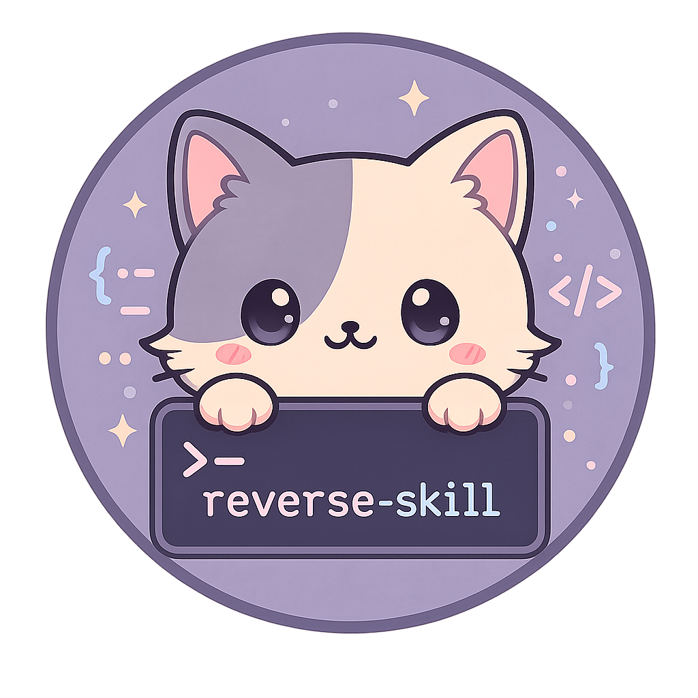
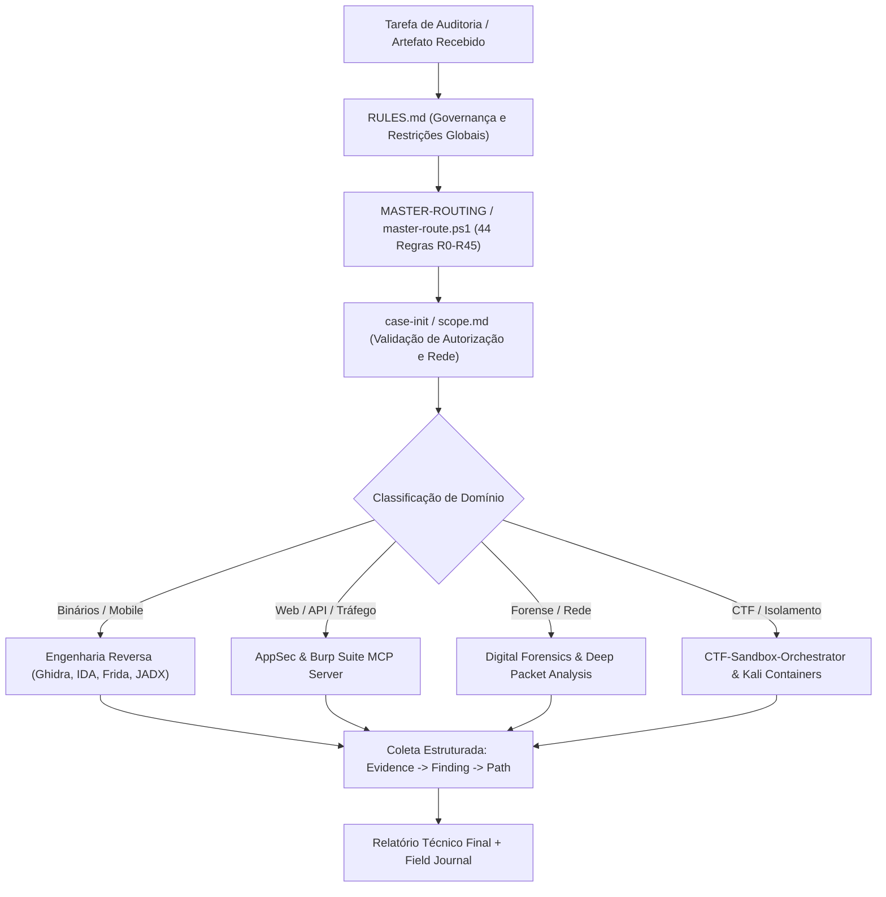

# reverse-skill

### Arquitetura Modular de Roteamento de Skills para Cibersegurança, Engenharia Reversa e Pentest Assistido por IA
*Deterministic Cybersecurity Skills Router, MCP Integration Suite & CTF Sandbox Orchestrator*

[-6366F1?style=for-the-badge)](skills/MASTER-ROUTING.md)

 

[Visão Geral](#visão-geral) • [Arquitetura de Roteamento](#arquitetura-de-roteamento) • [Taxonomia de Módulos](#taxonomia-de-módulos) • [Integração MCP & Sandboxes](#integração-mcp--sandboxes) • [Como Utilizar](#como-utilizar) • [English Overview](#english-overview)

---

## Visão Geral

O **reverse-skill** é um pacote de engenharia de segurança ofensiva/defensiva e engenharia reversa projetado para eliminar execuções improvisadas por agentes de IA (Claude Code, Cursor, Antigravity, OpenCode, Codex) durante auditorias de segurança autorizadas, análises de binários e competições CTF (*Capture The Flag*).

Quando um agente autônomo recebe um artefato complexo — como um pacote Android (`APK`), um binário nativo (`ELF`/`PE`), criptografia ofuscada em JavaScript no frontend, captura de pacotes de rede (`PCAP`), firmware embarcado ou ambiente web sob auditoria — este framework **roteia deterministicamente a tarefa para o protocolo técnico correto**, valida o escopo de autorização, verifica as ferramentas instaladas no host e impõe rastreabilidade de evidências (*Evidence -> Finding -> Path*).

### Problemas de Engenharia Resolvidos

1. **Seleção Determinística de Ferramental**: Evita que agentes tentem adivinhar entre `jadx`, `apktool`, `Frida`, `Ghidra`, `IDA Pro`, `Radare2` ou `Burp Suite` sem critério metodológico.
2. **Isolamento de Escopo e Governança (`scope.md`)**: Nenhuma ação ativa contra um alvo é disparada antes da inicialização formal do caso (`case-init`), verificação de autorização explícita e definição do perfil de rede.
3. **Padronização Multi-Plataforma**: Contratos operacionais independentes de cliente (*client-neutral*), validados em pipelines de integração contínua (Linux/Ubuntu, Kali Linux e Windows) com **175 casos de regressão**.
4. **Memória Operacional Reutilizável**: Consolidação automática de linha do tempo (*timeline*), relatórios técnicos estruturados e diário de campo (`field-journal`) para impedir repetição de falhas analíticas.

---

## Arquitetura de Roteamento

O núcleo do sistema opera como um pipeline de decisão em camadas regido por [`RULES.md`](RULES.md) e pela matriz primária [`skills/MASTER-ROUTING.md`](skills/MASTER-ROUTING.md):

---

## Taxonomia de Módulos

O repositório organiza **45 módulos especializados** em [`skills/`](skills/), além de orquestradores dedicados:

| Domínio Técnico | Módulos Principais Inclusos | Ferramentas e Protocolos Orquestrados |
| :--- | :--- | :--- |
| **Engenharia Reversa Nativa** | `ghidra-reverse`, `ida-reverse`, `go-rust-reverse`, `dotnet-reverse` | Descompilação ELF/PE/Mach-O, reconstrução de símbolos Go/Rust, análise IL/.NET e inspeção de CFG. |
| **Segurança Mobile & Hooking** | `competition-android-hooking` e playbooks Android/iOS | Instrumentação dinâmica com Frida, desempacotamento APK via JADX/Apktool e bypass de SSL Pinning em escopo autorizado. |
| **Segurança Web & APIs (MCP)** | [`burp-mcp-full/`](burp-mcp-full/), `identity-federation`, `database-security` | Integração direta via *Model Context Protocol* (MCP) com Burp Suite para inspeção HTTP/WebSockets, OAuth/OIDC/SAML e auditoria SQL. |
| **Firmware, Hardware & EDR** | `firmware-pentest`, `hardware-security`, `edr-bypass-re` | Extração de sistemas de arquivos embarcados, análise de interfaces UART/JTAG e estudo reverso de telemetria defensiva. |
| **Forense Digital & Redes** | `digital-forensics`, `email-security` | Análise de dumps de memória, dissecação de capturas PCAP/Wireshark, cabeçalhos SMTP/DKIM/DMARC e artefatos de disco. |
| **Orquestração CTF & Cloud** | [`CTF-Sandbox-Orchestrator/`](CTF-Sandbox-Orchestrator/), `ctf-sandbox`, [`kali/`](kali/) | Provisionamento isolado de containers Kali Linux e sandboxes reproduzíveis para resolução automatizada de desafios CTF. |
| **Documentação & Evidências** | `docs-generator`, `diagram-generator`, `field-journal` | Geração padronizada de laudos técnicos de vulnerabilidade, diagramas arquiteturais e registro auditável de comandos. |

---

## Integração MCP & Sandboxes

### 1. Servidor MCP Completo para Burp Suite ([`burp-mcp-full/`](burp-mcp-full/))
Permite conectar agentes compatíveis com *Model Context Protocol* diretamente ao proxy do Burp Suite, viabilizando leitura estruturada do histórico HTTP, repetição controlada de requisições, análise de tokens de sessão e verificação automatizada de falhas de controle de acesso (IDOR/BOLA).

### 2. Orquestrador de Sandbox CTF ([`CTF-Sandbox-Orchestrator/`](CTF-Sandbox-Orchestrator/))
Subsistema dedicado à execução isolada de binários não confiáveis e desafios de competição, separando o host principal da superfície de execução de exploits e hooks dinâmicos.

### 3. Ambiente Kali Linux ([`kali/`](kali/) & [`README-kali.md`](README-kali.md))
Scripts e perfis de preparação para ambientes Kali Linux, garantindo disponibilidade imediata das cadeias de ferramentas de análise estática e dinâmica.

---

## Como Utilizar

### Inicialização para Agentes de IA
Se você está acoplando este repositório a um agente autônomo de engenharia:
1. Instrua o agente a ler estritamente o bootstrap operacional em [`README_AI.md`](README_AI.md) e [`AGENTS.md`](AGENTS.md).
2. O agente consultará [`RULES.md`](RULES.md) e executará o roteamento primário definido em [`skills/MASTER-ROUTING.md`](skills/MASTER-ROUTING.md).
3. Consulte os exemplos práticos de fluxos completos em [`examples/`](examples/) e a documentação complementar em [`docs/`](docs/).

### Uso Ético e Conformidade Legal
Este repositório destina-se **exclusivamente** a auditorias de segurança formalmente autorizadas, pesquisa acadêmica em engenharia reversa, análise defensiva de malware/forense e competições oficiais de CTF. Consulte [`SECURITY.md`](SECURITY.md) para diretrizes de divulgação responsável.

---

## English Overview

**reverse-skill** is a client-neutral **Cybersecurity Skills Router** designed for AI coding and security agents. Instead of ad-hoc tool guessing when analyzing APKs, native ELF/PE binaries, obfuscated frontend cryptography, PCAP network traces, or web targets, it enforces a deterministic workflow:

* **44 Deterministic Routing Rules (`R0–R45`)** validated against **175 regression test cases**.
* **45 Specialized Skill Modules** spanning Ghidra/IDA reverse engineering, Go/Rust/.NET binary analysis, Frida dynamic instrumentation, digital forensics, firmware pentesting, and identity federation.
* **First-Class Tooling Bridges**: Includes [`burp-mcp-full/`](burp-mcp-full/) for Burp Suite MCP integration, [`CTF-Sandbox-Orchestrator/`](CTF-Sandbox-Orchestrator/) for isolated challenge execution, and [`kali/`](kali/) environment provisioning.
* For complete upstream English reference documentation, see [`README_UPSTREAM_EN.md`](README_UPSTREAM_EN.md) and [`README_AI.md`](README_AI.md).

---

## Licença e Créditos / License & Attribution

Distribuído sob a **Licença MIT** — consulte o arquivo [`LICENSE`](LICENSE) para detalhes completos.
Baseado na arquitetura open-source original [`zhaoxuya520/reverse-skill`](https://github.com/zhaoxuya520/reverse-skill), mantido e documentado neste repositório como referência arquitetural de roteamento de agentes para cibersegurança e engenharia reversa.
